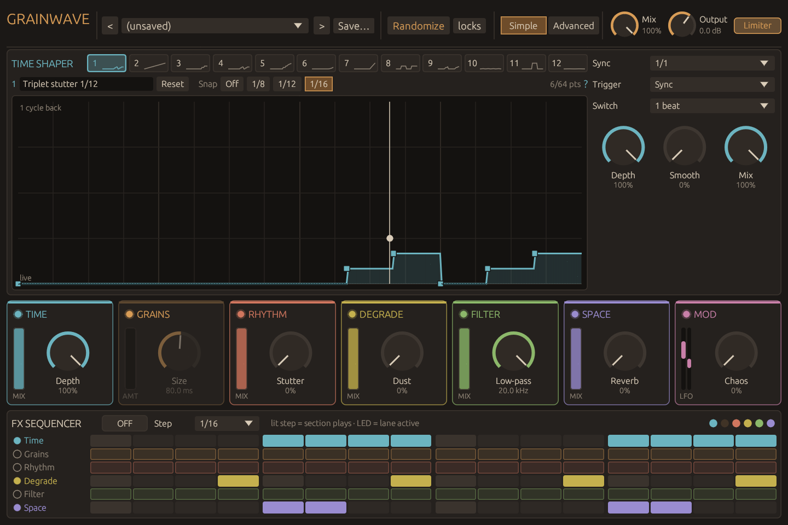
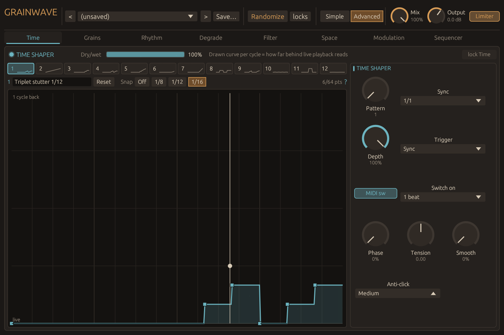
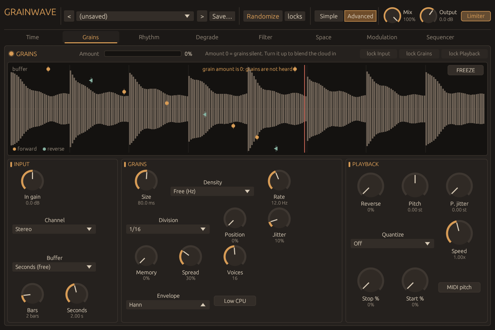
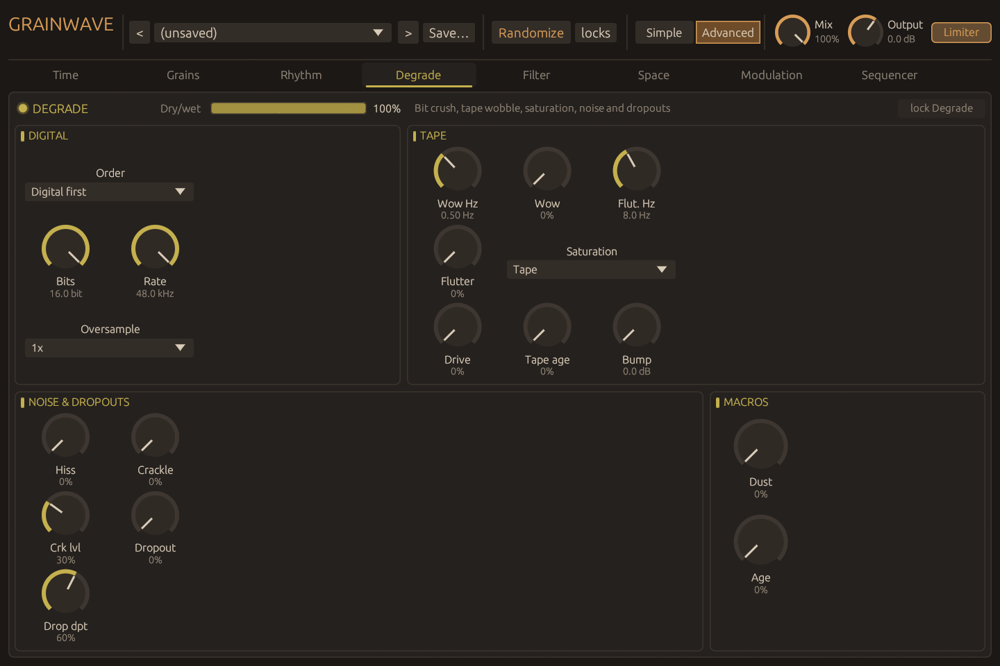
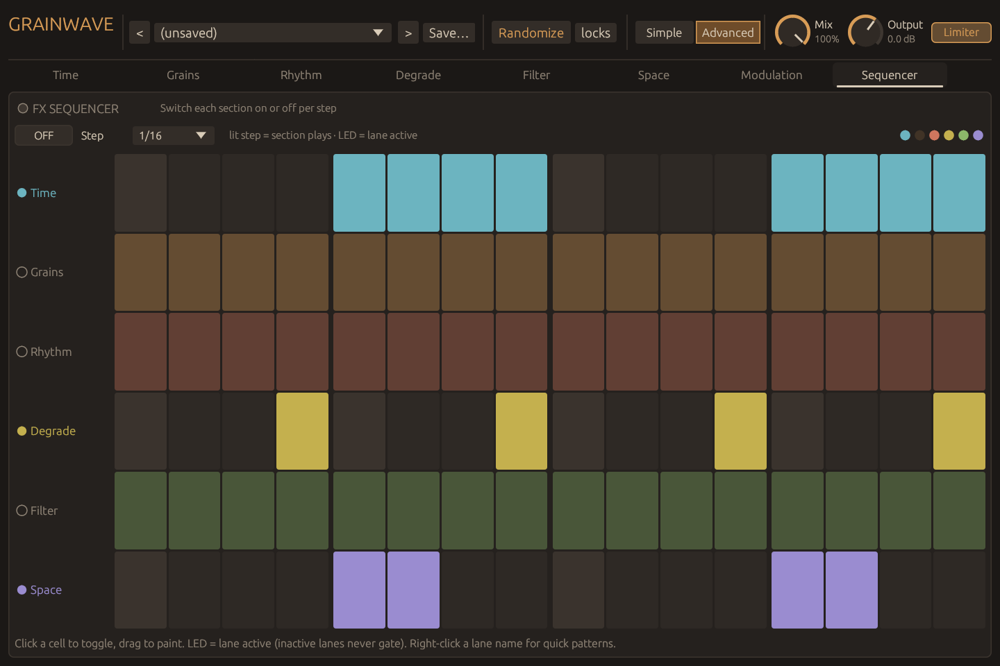

# Grainwave

Lofi time shaper and granular destroyer. Grainwave is built from separate effect units, each
with its own power switch and dry/wet:

- **Time:** a drawn curve per beat/bar sets how far behind live the playback reads, giving
  halftime, stutters, rolls and tape stops that stay locked to the beat.
- **Grains:** replays a rolling buffer as short grains (reversed, pitched, tape-stopped).
- **Rhythm, Degrade, Filter, Space, Modulation:** probabilistic stutter and gate, a lofi chain
  (crush, wow/flutter, saturation, hiss, crackle, dropouts), filters, reverb and delay, LFOs and
  macros.
- **FX sequencer:** 16-step lanes switch each unit on and off in time.

A fresh instance is transparent: everything starts clean and you dial the damage in.



**[Download the latest release](https://github.com/AnCarsenat/grainwave/releases/latest)**
(VST3 + CLAP for Linux, Windows and macOS)

- **Formats:** VST3, CLAP, standalone app (JACK/ALSA)
- **Platform:** Linux first. Windows and macOS build from the same code.
- **Stack:** Rust 2021, [nih-plug](https://github.com/robbert-vdh/nih-plug), egui GUI via `nih_plug_egui`
- **License:** GPL-3.0-or-later (required by the VST3 SDK bindings nih-plug uses)

> LV2 is not supported: nih-plug has no LV2 backend. CLAP covers most Linux hosts (Bitwig,
> Reaper, Ardour 8+, Qtractor). LV2 is on the roadmap via a separate wrapper.

---

## Contents

1. [Screenshots](#screenshots)
1. [Features](#features)
2. [Building](#building)
3. [Installing](#installing)
4. [Architecture](#architecture)
5. [Signal flow](#signal-flow)
6. [Real-time rules](#real-time-rules)
7. [Module specifications](#module-specifications)
8. [Parameter reference](#parameter-reference)
9. [Modulation and macros](#modulation-and-macros)
10. [GUI](#gui)
11. [Presets and state](#presets-and-state)
12. [Testing](#testing)
13. [CI and releases](#ci-and-releases)
14. [Branch ownership and workflow](#branch-ownership-and-workflow)
15. [Roadmap](#roadmap)

---

## Screenshots

The **Simple** page (above) holds the time-shaper curve editor, a row of separated effect units
(power LED, dry/wet fader, key knobs) and the FX sequencer. **Advanced** shows every parameter,
one tab per section:

| Time shaper | Grains |
|---|---|
|  |  |
| **Degrade** | **FX sequencer** |
|  |  |

Screenshots are rendered offscreen from the real editor (CPU rasterizer, no window) with demo
curve, sequencer and meter data; knobs show default values. Regenerate them with:

```sh
cargo test --release --lib screenshots -- --ignored
```

---

## Features

**Sections**
- Seven units: Time, Grains, Rhythm, Degrade, Filter, Space, Modulation
- Per-unit power switch and dry/wet, crossfaded over ~10 ms (no clicks); a unit keeps running
  while off, so switching it back on never replays stale audio
- Defaults are clean: Grain amount 0, reverse chance 0, time pattern 1 flat

**Time shaper**
- 12 editable curves per instance (12 musical factory curves: halftime, 1/8 and 1/12 triplet
  stutters, rolls, tape stop, reverse beat, beat repeats, stairs, swing drag, wobble)
- Sync 1/16 to 4 bars, triplet and dotted; phase, depth, tension, smoothing, mix
- Anti-click crossfade on jumps (Off / Low / Medium / High)
- Patterns switch by parameter or MIDI note (C = 1 … B = 12), quantized to the beat grid
- Trigger: host sync, or MIDI note restarts one cycle

**FX sequencer**
- 6 lanes × 16 steps (one lane per unit), step 1/4 … 1/16T, lane-active toggles
- Steps saved with the session and in presets

**Input / buffer**
- Rolling stereo capture buffer: 1–8 bars (tempo synced) or 0.5–8 s (free)
- Freeze: stops recording and holds the current buffer
- Input gain, dry/wet mix
- Channel modes: stereo, mono, mid/side

**Grain engine**
- Grain size 5–500 ms
- Density 1–64 grains/s, or tempo-synced divisions
- Position, position jitter, memory (how far back grains reach)
- Envelope: Hann, triangle, square, exponential decay
- 1–32 voices, random stereo spread per grain
- Low-CPU mode

**Playback**
- Reverse chance per grain
- Pitch ±24 st, pitch jitter, pitch quantize (octaves, fifths, major, minor, pentatonic)
- Tape-stop and tape-start chance per grain
- Speed 0.25×–4×
- MIDI pitch mode: held MIDI notes set grain pitch

**Rhythm and performance**
- Host BPM sync (falls back to 120 BPM and an internal clock)
- Stutter: 1/4, 1/8, 1/16, 1/32, 1/8T, 1/16T with probability
- Swing
- 16-step gate
- Rewind button, tape-stop button with adjustable time

**Degrade chain** (3 selectable orders)
- Bitcrush 1–16 bit, sample-rate reduction 1–48 kHz
- Wow and flutter (rate, depth)
- Saturation: tape, tube, hard clip, with 1×/2×/4× oversampling
- Tape age (high-frequency loss), head bump (low-end boost)
- Hiss, vinyl crackle (density, level), dropouts (chance, depth)

**Filter**
- Resonant low-pass and high-pass, slow random cutoff drift

**Space**
- Small reverb (size, mix)
- Tempo-synced delay with feedback and a crusher in the feedback path

**Modulation**
- 2 LFOs: sine, triangle, saw, square, random, smooth random. Free Hz or tempo synced.
- Input envelope follower
- Each source has one target from 22 modulatable parameters, bipolar amount

**Macros**
- Dust: clean to destroyed
- Chaos: scales every jitter and chance amount
- Age: wow, flutter, hiss and tape age together

**Utility**
- Output gain, safety limiter
- Preset browser (factory and user), randomize with per-section locks
- Live waveform with grain positions
- Undo/redo and MIDI learn come from the host (all parameters are automatable)

---

## Building

Requirements: Rust 1.80+ (tested on 1.96), a C compiler, and on Linux the X11/GL dev packages
used by the GUI and standalone:

```sh
# Arch
sudo pacman -S --needed base-devel libx11 libxcursor libxcb xcb-util-wm mesa jack2 alsa-lib
# Debian/Ubuntu
sudo apt install build-essential libx11-xcb-dev libxcursor-dev libxcb-icccm4-dev \
  libgl-dev libjack-jackd2-dev libasound2-dev
```

Commands:

```sh
cargo build                          # debug build, aborts on audio-thread allocations
cargo test                           # unit tests for every DSP module
cargo xtask bundle grainwave --release   # VST3 + CLAP bundles in target/bundled/
cargo run --release --bin grainwave_standalone -- --help   # standalone app
```

Debug builds enable nih-plug's `assert_process_allocs`: any heap allocation inside `process()`
aborts the plugin. Always test new DSP code in a debug build at least once.

## Installing

```sh
cargo xtask bundle grainwave --release
mkdir -p ~/.vst3 ~/.clap
cp -r target/bundled/Grainwave.vst3 ~/.vst3/
cp    target/bundled/Grainwave.clap ~/.clap/
```

Then rescan plugins in your host.

For development, symlink instead of copying so every `cargo xtask bundle` is picked up after a
host rescan or restart:

```sh
ln -sfn "$PWD/target/bundled/Grainwave.vst3" ~/.vst3/Grainwave.vst3
ln -sfn "$PWD/target/bundled/Grainwave.clap" ~/.clap/Grainwave.clap
```

---

## Architecture

```
src/
  lib.rs          Plugin impl: params, initialize, process loop, CLAP/VST3 export  (shared)
  main.rs         Standalone entry point                                           (shared)
  params.rs       All parameters, enums, and Snapshot                              (shared)
  shared.rs       Lock-free VisualState between audio thread and GUI              (shared)
  pattern.rs      Time-shaper curve model, value_at, factory curves               (shared) + feat/timeshape
  editor/         egui editor: simple/advanced pages, curve editor, sequencer     feat/ui-v2
  presets.rs      Preset load/save                                                feat/ui-v2
  dsp/
    mod.rs        Transport struct, module contract                                (shared)
    rng.rs        Allocation-free xorshift RNG                                     (shared)
    timeshape.rs  Time shaper                                                     feat/timeshape
    input.rs      Channel mode encode/decode                                      feat/grain-engine
    grains.rs     Capture buffer, scheduler, voices, playback modes               feat/grain-engine
    rhythm.rs     Stutter, swing, gate, rewind, tape stop                         feat/rhythm
    degrade/      Degrade chain (mod, oversample, saturation, wow, tone, noise)   feat/degrade
    filter.rs     Low-pass / high-pass / drift                                    feat/degrade
    space.rs      Reverb + delay                                                  feat/space-output
    output.rs     Output gain + limiter                                           feat/space-output
    modulation.rs LFOs, envelope follower, macros                                 feat/modulation
presets/          Factory presets (JSON)                                          feat/ui-v2
xtask/            nih-plug bundler
.github/workflows CI (build, test) and release (bundles on v* tags)
docs/             Design notes per module
```

### Threads

| Thread | Runs | May allocate? |
|---|---|---|
| Audio | `Plugin::process`, every `dsp::*::process*` | No |
| Host main | `initialize`, `new`, state load/save | Yes |
| Audio (rare) | `Plugin::reset` | No (buffers are reused, see `dsp::realloc_or_clear`) |
| GUI | `editor.rs`, `presets.rs` | Yes |

The audio thread and the GUI communicate only through:
- **Parameters** (`Arc<GrainwaveParams>`): GUI writes via `ParamSetter`, audio reads.
- **`VisualState`** (`Arc`, atomics): audio writes, GUI reads. f32 stored as bits in `AtomicU32`,
  `Relaxed` ordering. Exceptions: `gate_step`, `ts_active` and `seq_step` are plain integers
  (read with `.load()`).
- **Time patterns** (`Arc<RwLock<PatternBank>>`, persisted): GUI writes then bumps
  `pattern_version`; audio copies with `try_read` into preallocated storage, never blocking.
- **Sequencer lanes** (six persisted `Arc<AtomicU32>`): GUI writes, audio reads lock-free.

### Module contract

Every DSP module follows the same shape (see `src/dsp/mod.rs`):

```rust
pub fn new(...) -> Self                     // may allocate
pub fn reset(&mut self, sample_rate: f32, max_block: usize)   // clears state; allocates only if the size changed
pub fn process(&mut self, l: &mut [f32], r: &mut [f32], snap: &Snapshot, t: &Transport)
```

- `process` works in place on one stereo block, `l.len() == r.len() <= max_block`.
- Parameter values come only from `&Snapshot` (a plain copy taken once per block), never from
  `GrainwaveParams`. This lets the modulation module rewrite values before DSP sees them.
- Values in `Snapshot` can arrive outside their nominal range after modulation; modules clamp.
- Per-block parameter changes must not click: smooth internally (one-pole, ~10–30 ms) any value
  that scales audio directly.
- Randomness uses `dsp::rng::Rng` with a fixed seed per module instance.

`Transport` gives `sample_rate`, `bpm` (120 if the host gives none), `beat_pos` in quarter notes
at the block start (internal free-running counter if the host gives none), `playing`,
`block_len`, and `samples_per_beat()`.

## Signal flow

```
host in ─► input gain ─┬──────────────────────────────────────────────────────────────┐ dry
                       │                                                               ▼
                       ├─► modulation (if on; rewrites Snapshot)                     mix ─► output ─► host out
                       │                                                               ▲
                       └─► encode ─► [time] ─► [grains] ─► [rhythm] ─► [degrade] ─► [filter] ─► [space] ─► decode ┘ wet
```

- Each `[section]` runs inside a stage fade: `out = in + (section(in) − in) × gain`, with
  `gain = power × section mix × sequencer step` smoothed by a 10 ms one-pole. Grains use Grain
  amount as their mix; Time also has its own internal `ts_mix`.
- Sections keep processing while their gain is 0.
- MIDI note-ons go to the grain engine (pitch) and the time shaper (pattern switch / trigger).
- Dry/wet mix ramps linearly across the block from the previous value to avoid zipper noise.
- No plugin latency is reported (no lookahead anywhere in the chain).

## Real-time rules

1. No allocation, locking, file or console I/O, or syscalls in any `process*` function.
2. Pre-allocate in `reset()`, sized for the worst case at the current sample rate.
3. No `Vec::push`, `format!`, `String`, `Box::new`, `collect()` on the audio thread.
4. Flush NaN/inf: the output module replaces any non-finite sample with 0.
5. Avoid denormals: add a tiny DC offset (1e-20) in feedback paths, or flush below 1e-15.
6. Feedback paths (delay, reverb, filters) must stay stable for every parameter value.

---

## Module specifications

These are the target behaviors. Implementation notes and deviations live in [`docs/`](docs/README.md).
Main deviations in the shipped code:

- Capture buffer is 32 s + 1 s guard; voice stealing fades over 2 ms instead of cutting.
- Stutter keeps looping the same slice while the chance roll keeps succeeding.
- Inside Space, the delay feeds the reverb. Delay time changes use a linear (not equal-power)
  crossfade to keep the feedback loop stable.
- Degrade stages and filters crossfade in/out instead of hard bypass; neutral settings are
  bit-transparent.
- Oversampling adds ~23 samples of unreported latency at 2× (see [docs/degrade.md](docs/degrade.md)).

### Input (`dsp/input.rs`)
- **Stereo:** no-op.
- **Mono:** `l = r = (l + r) / 2` on encode; decode no-op.
- **Mid/side:** encode `l = (l + r) / 2` (M), `r = (l - r) / 2` (S); decode `L = M + S`, `R = M - S`.

### Grain engine (`dsp/grains.rs`)
- **Capture buffer:** stereo circular buffer, capacity 32 s at the current sample rate, allocated
  in `reset()`. Effective length `L` = `buffer_seconds` (free) or `buffer_bars × 4 × samples_per_beat`
  (synced), clamped to capacity. Freeze stops writes; grains keep reading.
- **Scheduler:** spawns a grain every `sr / density_hz` samples (free) or every
  `division.beats() × samples_per_beat` aligned to the host grid (synced). Small random timing
  jitter (±10 % × `position_jitter`) in free mode.
- **Read position:** `max_lookback = L × (0.1 + 0.9 × memory)`;
  `lookback = position × max_lookback ± position_jitter × max_lookback / 2`. Clamped so a forward
  grain never reads past the write head.
- **Rate:** `speed × 2^((pitch_st + jitter + midi_offset) / 12)`, where `jitter` is uniform in
  ±`pitch_jitter_st`. With quantize on, the total semitone offset snaps to the nearest allowed
  degree (octaves: multiples of 12; fifths: 0, 7 per octave; scales relative to 0 = root).
- **Reverse:** with probability `reverse_chance`, the grain reads backwards from the end of its span.
- **Tape stop / start:** with probability `tape_stop_chance`, rate ramps from full to 0 over the
  grain (`rate × (1 − t)²`); with `tape_start_chance`, from 0 to full (`rate × t²`).
- **Interpolation:** 4-point cubic Hermite.
- **Envelope:** Hann, triangle, square (2 ms edges), exponential decay (5 ms attack).
- **Voices:** fixed pool (32 voices + 8 release slots); `max_voices` active (8 when `low_cpu`). When full, the oldest fades out over 2 ms.
- **Spread:** each grain gets a random pan in ±`spread`, equal-power law.
- **Gain:** output scaled by `1 / sqrt(max(1, density × size_s))` to keep loudness steady.
- **MIDI pitch:** when on, `midi_offset = last_held_note − 60` and grains spawn only while a note
  is held. When off, MIDI is ignored.
- **Visual:** writes active voice positions/reverse flags, write head, and waveform peaks
  (256 slices, one slice refreshed per block) to `VisualState`.

### Rhythm (`dsp/rhythm.rs`)
- Own circular buffer, 4 s capacity.
- **Grid:** step boundaries from `Transport::beat_pos`. Swing delays every odd step by
  `swing × 0.5 × step_length`.
- **Stutter:** at each `stutter_division` boundary, with probability `stutter_chance`, repeat the
  most recent slice of that length until the next boundary. 2 ms crossfades at edges.
- **Gate:** when enabled, 16 steps of 1/16 over one bar. Off steps mute with a 3 ms ramp.
  Writes the current step to `VisualState::gate_step`.
- **Rewind** (momentary): reads its buffer backwards, speed accelerating from 1× to 3× over 1 s,
  with a 10 ms crossfade in and out.
- **Tape stop** (momentary): playback rate falls from 1 to 0 over `tape_stop_time_ms`
  (quadratic), silence while held, spins back up over half that time on release, then crossfades
  to live audio.

### Degrade (`dsp/degrade.rs`)
Stage order from `degrade_order`:

| Order | Stages |
|---|---|
| Digital first | crush → sample rate → wow/flutter → saturation → tape age + head bump → noise → dropouts |
| Tape first | wow/flutter → saturation → tape age + head bump → crush → sample rate → noise → dropouts |
| Drive first | saturation → crush → sample rate → wow/flutter → tape age + head bump → noise → dropouts |

- **Bitcrush:** `q = 2^(bits − 1)`, `y = round(x × q) / q`; bypass at 16 bits. Fractional bits allowed.
- **Sample rate:** sample-and-hold with a phase accumulator; bypass at ≥ host rate.
- **Wow/flutter:** modulated delay line (5 ms base). Wow: sine + smoothed random, ±3 ms max.
  Flutter: sine, ±0.3 ms max. Cubic interpolation.
- **Saturation:** drive gain `1 + 19 × drive`, output compensated by `1 / sqrt(gain)`. Tape:
  asymmetric tanh. Tube: `x + 0.2x²` then soft clip, DC-blocked. Hard clip: clamp ±1. Runs at
  1×/2×/4× via polyphase halfband up/downsampling. Bypass at drive 0.
- **Tape age:** 2-pole low-pass sweeping 20 kHz → 2.5 kHz (exponential in `tape_age`).
- **Head bump:** RBJ peaking EQ, 90 Hz, Q 1.0, `head_bump_db` gain.
- **Hiss:** pink-ish filtered noise, level −90 dB → −30 dB.
- **Crackle:** random impulses at up to 30/s × `crackle_density`, 0.5 ms decaying clicks, random
  amplitude × `crackle_level`, occasional larger pops.
- **Dropouts:** every 50 ms, with probability `dropout_chance`, dip gain to `1 − dropout_depth` for
  50–300 ms with 20 ms ramps.

### Filter (`dsp/filter.rs`)
- TPT state-variable filters (Zavalishin), 12 dB/oct low-pass and high-pass in series.
- Resonance 0–1 maps to Q 0.707–10.
- Drift: smoothed random walk, ±1 octave × `filter_drift`, about 0.3 Hz.
- Cutoffs clamped to 20 Hz – 0.45 × sample rate.

### Space (`dsp/space.rs`)
- **Reverb:** 8-line feedback delay network with Householder mixing and damping, decay
  0.3–6 s from `reverb_size`. Equal-power wet/dry by `reverb_mix`. Bypass at mix 0.
- **Delay:** stereo, time = `delay_division.beats() × samples_per_beat` (max 4 s), feedback up to
  0.95 with a 6 kHz low-pass in the loop, crusher in the loop (bit depth `16 − 12 × delay_crush`,
  matching sample-rate reduction). Wet/dry by `delay_mix`. Smooth time changes (no clicks).

### Output (`dsp/output.rs`)
- Output gain smoothed (20 ms one-pole).
- Limiter (when on): peak limiter, instant attack, 100 ms release, ceiling −0.3 dBFS.
- Always: replace NaN/inf with 0, final clamp to ±1.

### Modulation (`dsp/modulation.rs`)
See [Modulation and macros](#modulation-and-macros).

---

## Parameter reference

IDs are stable: renaming one breaks saved sessions. Nested arrays get a numeric suffix
(`on_1` … `on_16`, `shape_1`, `shape_2`, …).

### Input
| ID | Name | Range | Default |
|---|---|---|---|
| `in_gain` | Input gain | −24 … +24 dB | 0 dB |
| `ch_mode` | Channel mode | Stereo / Mono / Mid-Side | Stereo |
| `buf_mode` | Buffer mode | Bars (synced) / Seconds (free) | Seconds |
| `buf_bars` | Buffer bars | 1 … 8 | 2 |
| `buf_secs` | Buffer length | 0.5 … 8 s | 2 s |
| `freeze` | Freeze | on/off | off |

### Grains
| ID | Name | Range | Default |
|---|---|---|---|
| `g_size` | Grain size | 5 … 500 ms | 80 ms |
| `g_dmode` | Density mode | Free / Synced | Free |
| `g_dens` | Density | 1 … 64 Hz | 12 Hz |
| `g_ddiv` | Density division | 1/4 … 1/16T | 1/16 |
| `g_pos` | Position | 0 … 100 % | 0 % |
| `g_jit` | Position jitter | 0 … 100 % | 10 % |
| `g_mem` | Memory | 0 … 100 % | 0 % |
| `g_env` | Grain envelope | Hann / Triangle / Square / Exp decay | Hann |
| `g_voices` | Max voices | 1 … 32 | 16 |
| `g_spread` | Stereo spread | 0 … 100 % | 30 % |
| `g_lowcpu` | Low CPU | on/off | off |

### Playback
| ID | Name | Range | Default |
|---|---|---|---|
| `p_rev` | Reverse chance | 0 … 100 % | 0 % |
| `p_pitch` | Pitch | −24 … +24 st | 0 |
| `p_pjit` | Pitch jitter | 0 … 12 st | 0 |
| `p_quant` | Pitch quantize | Off / Octaves / Fifths / Major / Minor / Pentatonic | Off |
| `p_stop` | Tape-stop chance | 0 … 100 % | 0 % |
| `p_start` | Tape-start chance | 0 … 100 % | 0 % |
| `p_speed` | Speed | 0.25 … 4× | 1× |
| `p_midi` | MIDI pitch | on/off | off |

### Rhythm
| ID | Name | Range | Default |
|---|---|---|---|
| `r_stut` | Stutter division | 1/4 … 1/16T | 1/16 |
| `r_stch` | Stutter chance | 0 … 100 % | 0 % |
| `r_swing` | Swing | 0 … 100 % | 0 % |
| `r_gate` | Gate | on/off | off |
| `on_1` … `on_16` | Gate steps | on/off | on |
| `r_rewind` | Rewind | momentary | off |
| `r_tstop` | Tape stop | momentary | off |
| `r_tstopt` | Tape-stop time | 50 … 4000 ms | 600 ms |

### Degrade
| ID | Name | Range | Default |
|---|---|---|---|
| `d_order` | Degrade order | Digital / Tape / Drive first | Digital first |
| `d_bits` | Bit depth | 1 … 16 bit | 16 |
| `d_srate` | Sample rate | 1 … 48 kHz | 48 kHz |
| `d_wowr` / `d_wowd` | Wow rate / depth | 0.05 … 4 Hz / 0 … 100 % | 0.5 Hz / 0 % |
| `d_flr` / `d_fld` | Flutter rate / depth | 4 … 30 Hz / 0 … 100 % | 8 Hz / 0 % |
| `d_satm` | Saturation | Tape / Tube / Hard clip | Tape |
| `d_drive` | Drive | 0 … 100 % | 0 % |
| `d_age` | Tape age | 0 … 100 % | 0 % |
| `d_bump` | Head bump | 0 … 9 dB | 0 dB |
| `d_hiss` | Hiss | 0 … 100 % | 0 % |
| `d_crdens` / `d_crlvl` | Crackle density / level | 0 … 100 % | 0 % / 30 % |
| `d_dropch` / `d_dropd` | Dropout chance / depth | 0 … 100 % | 0 % / 60 % |
| `d_os` | Oversampling | 1× / 2× / 4× | 1× |

### Filter
| ID | Name | Range | Default |
|---|---|---|---|
| `f_lp` / `f_lpq` | Low-pass / resonance | 20 Hz … 20 kHz / 0 … 100 % | 20 kHz / 0 % |
| `f_hp` / `f_hpq` | High-pass / resonance | 20 Hz … 20 kHz / 0 … 100 % | 20 Hz / 0 % |
| `f_drift` | Filter drift | 0 … 100 % | 0 % |

### Space
| ID | Name | Range | Default |
|---|---|---|---|
| `s_rvsize` / `s_rvmix` | Reverb size / mix | 0 … 100 % | 50 % / 0 % |
| `s_dldiv` | Delay time | 1/4 … 1/16T | 1/8 |
| `s_dlfb` | Delay feedback | 0 … 95 % | 35 % |
| `s_dlmix` | Delay mix | 0 … 100 % | 0 % |
| `s_dlcrush` | Delay crush | 0 … 100 % | 0 % |

### Modulation
| ID | Name | Range | Default |
|---|---|---|---|
| `shape_N` | LFO N shape | Sine / Triangle / Saw / Square / Random / Smooth random | Sine |
| `rmode_N` | LFO N rate mode | Free, 1/1, 1/2, 1/4, 1/8, 1/16, 2 bars, 4 bars | Free |
| `hz_N` | LFO N rate | 0.01 … 20 Hz | 0.5 Hz |
| `target_N` | LFO N target | see `ModTarget` | None |
| `amt_N` | LFO N amount | −1 … +1 | 0 |
| `env_target` | Envelope target | see `ModTarget` | None |
| `env_amt` | Envelope amount | −1 … +1 | 0 |
| `env_att` / `env_rel` | Envelope attack / release | 0.1 … 500 ms / 1 … 2000 ms | 10 / 150 ms |

### Sections
| ID | Name | Range | Default |
|---|---|---|---|
| `on_time`, `on_grain`, `on_rhythm`, `on_degrade`, `on_filter`, `on_space`, `on_mod` | Section power | on/off | on |
| `g_amt` | Grain amount | 0 … 100 % | 0 % |
| `r_amt`, `d_amt`, `f_amt`, `s_amt` | Rhythm / Degrade / Filter / Space mix | 0 … 100 % | 100 % |

### Time shaper
| ID | Name | Range | Default |
|---|---|---|---|
| `ts_pat` | Time pattern | 1 … 12 | 1 (flat) |
| `ts_sync` | Time sync | 1/16 … 4/1, triplets, dotted | 1/1 |
| `ts_trig` | Time trigger | Sync / MIDI | Sync |
| `ts_patq` | Pattern quantize | Off, 1/4 beat … 1 bar | 1 beat |
| `ts_midisw` | MIDI switches pattern | on/off | on |
| `ts_depth` | Time depth | 0 … 100 % | 100 % |
| `ts_phase` | Time phase | 0 … 100 % | 0 % |
| `ts_tension` | Time tension | −1 … +1 | 0 |
| `ts_smooth` | Time smooth | 0 … 100 % | 0 % |
| `ts_aclick` | Anti-click | Off / Low / Medium / High | Medium |
| `ts_mix` | Time mix | 0 … 100 % | 100 % |

### FX sequencer
| ID | Name | Range | Default |
|---|---|---|---|
| `sq_on` | FX sequencer | on/off | off |
| `sq_rate` | Sequencer step | 1/4 … 1/16T | 1/16 |

Lane steps are persisted state (`seq-time` … `seq-space`), not parameters.

### Macros and output
| ID | Name | Range | Default |
|---|---|---|---|
| `m_dust` | Dust | 0 … 100 % | 0 % |
| `m_chaos` | Chaos | 0 … 100 % | 0 % |
| `m_age` | Age | 0 … 100 % | 0 % |
| `mix` | Mix | 0 … 100 % | 100 % |
| `out_gain` | Output gain | −24 … +12 dB | 0 dB |
| `limiter` | Limiter | on/off | on |

---

## Modulation and macros

`Modulation::process_block` runs once per block, before any DSP, and rewrites `Snapshot`:

1. **Macros** move values toward a target with `v = lerp(v, target, amount)`:
   - **Dust:** bit depth → 6, sample rate → 8 kHz (interpolated in log space), drive → 0.6,
     tape age → 0.7, hiss → 0.35, crackle density → 0.5, wow depth → 0.35, flutter depth → 0.25,
     low-pass → 3 kHz (log space), dropout chance → 0.15.
   - **Age:** wow depth → 0.6, flutter depth → 0.4, hiss → 0.4, tape age → 0.8.
   - **Chaos** scales randomness: for every chance or jitter value (position jitter, reverse,
     stutter, tape stop, tape start, dropout chance, filter drift),
     `v = clamp(v × (1 + 2c) + 0.15c, 0, 1)`. Pitch jitter: `v × (1 + 2c) + 2c` semitones.
2. **LFOs and envelope follower** add an offset: `offset = source × amount × span`, where `span`
   is the target's full range. Hz and cutoff targets are modulated in log space (±1 = ± the full
   log range); everything else linearly. Results are clamped to the parameter's range.
3. LFO phase: free mode runs in Hz; synced modes derive phase from `Transport::beat_pos` so they
   lock to the host grid. Random shapes pick a new value each cycle; smooth random interpolates
   with a cosine curve.
4. Envelope follower: peak detector on the input block with one-pole attack/release, output 0–1.
5. Current LFO and envelope values go to `VisualState` for the GUI.

---

## GUI

egui editor, 960 × 640 default, minimum 820 × 560. Everything fits without scrolling; see
[docs/ui.md](docs/ui.md) for the size budget.

- **Top bar:** preset browser, Randomize (with lock groups), Simple/Advanced toggle, Mix,
  Output, Limiter.
- **Simple page:** time-shaper curve editor with 12 pattern buttons; a row of seven effect units
  (power LED, dry/wet fader, 1–2 key knobs, dimmed when off or gated); the FX sequencer grid.
- **Advanced page:** one tab per area with every parameter, each tab headed by its section's
  power switch and dry/wet. The waveform with live grain markers is on the Grains tab.
- **Curve editor:** click to add points, drag, Shift-drag for tension, right-click to change the
  segment shape (curve, S-curve, hold), double-click to delete, snap to 1/8, 1/12 or 1/16.
- All parameter edits go through `ParamSetter` so hosts record automation and undo. Curve and
  sequencer edits are saved with the session.

## Presets and state

- Session state is saved by the host through nih-plug (all parameters + editor size).
- Preset files are JSON:

  ```json
  { "name": "Dusty Memory", "author": "Grainwave", "version": 1,
    "params": { "g_size": 0.42, "m_dust": 0.6 } }
  ```

  Values are **normalized** (0–1) and keyed by parameter ID. Missing IDs keep their default, so old
  presets survive new parameters.
- Optional `"time_patterns"` (full curve bank) and `"seq_lanes"` (six lane words) replace the
  bank / lanes when present and leave them alone when absent.
- Factory presets: `presets/*.json` (18: grain textures, time-shaper grooves, sequencer
  patterns), compiled in with `include_str!`.
- User presets: `$XDG_CONFIG_HOME/grainwave/presets/` (fallback `~/.config/grainwave/presets/`).
- Preset I/O runs on the GUI thread only.

## Testing

- Each DSP file has `#[cfg(test)]` unit tests. Minimum per module:
  - silence in gives silence out (except intentional noise stages);
  - output is finite for extreme parameter values (fuzzed with `Rng` over many blocks);
  - neutral settings are transparent (or as close as the algorithm allows);
  - block size independence where it applies (1, 64, 512-sample blocks give the same result).
- `cargo test` must pass and `cargo build` must have zero warnings before merging.
- Manual check: load the debug build in a host (or run the standalone) to catch audio-thread
  allocations.

## CI and releases

- **`.github/workflows/ci.yml`:** on pushes to `main` and pull requests: build with
  `-D warnings`, `cargo test`, clippy (advisory).
- **`.github/workflows/release.yml`:** on a `v*` tag that matches the `Cargo.toml` version,
  bundles VST3 + CLAP for Linux x86_64, Windows x86_64 and universal macOS, zips them and
  publishes a GitHub release with install notes. Manual runs (`workflow_dispatch`) produce the
  zips as artifacts without releasing.

To release:

```sh
# bump version in Cargo.toml, commit, then
git tag v0.2.0
git push origin main v0.2.0
```

macOS bundles are unsigned; users run `xattr -dr com.apple.quarantine <bundle>` once.

---

## Branch ownership and workflow

Features are built in parallel on separate branches. Each branch owns specific files and must
not edit files owned by another branch. Shared files (`lib.rs`, `params.rs`, `shared.rs`,
`dsp/mod.rs`, `dsp/rng.rs`, `Cargo.toml`) change only when unavoidable, with minimal edits
(append only in `params.rs`), and the change is called out in the commit message.

| Branch | Owns | Scope |
|---|---|---|
| `feat/grain-engine` | `dsp/grains.rs`, `dsp/input.rs` | Input/buffer, grain engine, playback modes, MIDI pitch |
| `feat/rhythm` | `dsp/rhythm.rs` | Stutter, swing, gate, rewind, tape stop |
| `feat/degrade` | `dsp/degrade.rs`, `dsp/filter.rs` | Degrade chain, oversampling, filters |
| `feat/space-output` | `dsp/space.rs`, `dsp/output.rs` | Reverb, delay, output gain, limiter |
| `feat/modulation` | `dsp/modulation.rs` | LFOs, envelope follower, macros |
| `feat/ui` → `feat/ui-v2` | `editor/`, `presets.rs`, `presets/` | GUI, curve editor, sequencer grid, presets, randomize |
| `feat/timeshape` | `dsp/timeshape.rs`, `factory_bank()` in `pattern.rs` | Time shaper, factory curves |

`main` is integration only: branches merge into it once tests pass. Docs in `docs/` and this
README are maintained on `main`.

Commit style: Conventional Commits (`feat(grains): ...`, `fix(degrade): ...`, `test(...)`).

## Roadmap

- **v0.1 (MVP):** buffer, grain size/density/position/jitter, reverse chance, pitch,
  bitcrush/sample rate, wow/flutter, low-pass, Dust, mix.
- **v0.2:** granular/lofi feature set. Implemented (six feature branches).
- **v0.3:** section power switches and mixes, clean defaults, time shaper, FX sequencer,
  simple/advanced GUI, CI and release workflows. Implemented (132 unit tests). Open issues in
  [docs/README.md](docs/README.md#known-issues-to-fix-next).
- **Later:** LV2 build, per-grain filter, sample-accurate automation, multiple modulation
  targets per source, preset tagging, oversampling for the whole degrade chain.
